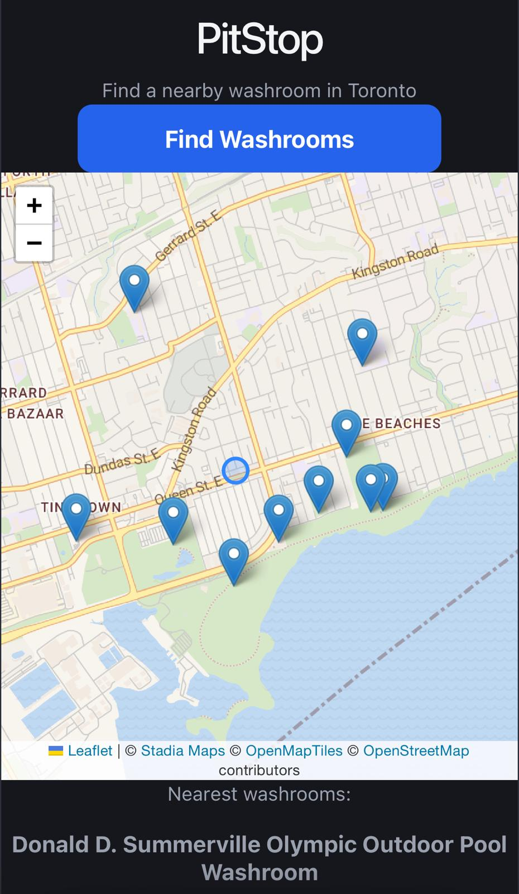

# PitStop

**Find the nearest open washroom in Toronto, fast.**

I drive rideshare in Toronto. Finding a washroom between trips is a real daily problem. Most map apps show places, but not whether the washroom is open right now or how far away it is. So I built PitStop: one button, the nearest washrooms, their hours, and directions.

**Live demo:** https://victorious-glacier-0d26ba81e.5.azurestaticapps.net



## Features

- Finds the 10 nearest washrooms within 3 km of your location
- Shows distance and today's hours ("Open until 10:00 PM", "Open 24 hours", or "Hours unknown")
- One tap "Get Directions" opens Google Maps
- Map with pins, shown after searching so the list comes first
- Mobile-first design with large tap targets, built for use in a car

## Tech stack

| Layer     | Technology                                                                                               |
| --------- | -------------------------------------------------------------------------------------------------------- |
| Backend   | C#, ASP.NET Core Minimal API, Entity Framework Core                                                      |
| Database  | PostgreSQL                                                                                               |
| Frontend  | React, TypeScript, Vite, React Leaflet                                                                   |
| Map tiles | Stadia Maps (OpenStreetMap data)                                                                         |
| Testing   | xUnit                                                                                                    |
| Hosting   | Azure App Service (API), Azure Database for PostgreSQL Flexible Server, Azure Static Web Apps (frontend) |
| CI/CD     | GitHub Actions (frontend deploys on every push to `main`)                                                |

## Architecture

```
React (Azure Static Web Apps)
        |  GET /washrooms/nearby?latitude=..&longitude=..
        v
ASP.NET Core Minimal API (Azure App Service)
        |  EF Core
        v
PostgreSQL (Azure Flexible Server)
        ^
        |  import jobs
City of Toronto Open Data + OpenStreetMap (Overpass)
```

- The backend calculates distance, filters to 3 km, sorts, and returns the nearest 10.
- The backend also builds the hours text (`HoursText`), so the frontend only displays it. One source of truth for "is it open".
- The `/nearby` endpoint is rate limited (30 requests per minute per IP).
- Import endpoints only run in Development, so they are not exposed in production.

## Data sources

- **City of Toronto Open Data:** public washrooms in parks and community centres
- **OpenStreetMap:** stores with public washrooms (for example McDonald's, Loblaws, Home Depot), including their `opening_hours`

## Interesting problems I solved

**1. Stores that close at midnight were hidden all day.**
My "is it open" check assumed closing time is always later than opening time. A store open 5:00 AM to 12:00 AM broke that rule. I found it with breakpoints, then handled overnight hours as a separate case (OR instead of AND).

**2. The hours parser failed on 45% of real data.**
I added tracepoints to log every parse result and grouped the output with PowerShell to find the most common failure patterns. Then I fixed them one by one (day ranges like `Mo-Fr`, comma lists, `24:00`, times with no days). Success went from 55% to 97%, and I added xUnit tests for each pattern.

**3. "Open 24 hours" showed as "Open until 11:59 PM".**
PostgreSQL stores time with 6 decimal places and .NET uses 7, so `TimeOnly.MaxValue` lost precision in the database and no longer matched. I changed the check to `close >= 23:59`.

**4. The map was blocked in production but worked locally.**
Two map providers blocked my tiles. In DevTools I found that Azure Static Web Apps sends `Referrer-Policy: same-origin` by default, so tile requests had no Referer and domain authentication failed. I overrode the header in `staticwebapp.config.json`.

## Running locally

### Backend

Requirements: .NET SDK, PostgreSQL

```bash
cd PitStop.API
dotnet user-secrets set "ConnectionStrings:PitStopDatabase" "Host=localhost;Database=pitstop;Username=...;Password=..."
dotnet ef database update
dotnet run
```

The API needs a `FrontendOrigin` setting (the frontend URL, for CORS). It fails at startup if it is missing.

To load data in Development, call the import endpoints (for example `POST /washrooms/import-osm-all`).

### Frontend

```bash
cd pitstop-web
npm install
npm run dev
```

Set `VITE_API_BASE_URL` to your API address.

### Tests

```bash
dotnet test
```

## Known issues and next steps

- **Seasonal closures:** the City dataset has a daily `status` field (open, closed, service alert). PitStop does not use it yet, so some park washrooms may show as open in winter.
- **Manual imports:** data only updates when I run the import. Next step: a scheduled daily import.
- **Duplicate import code:** the OpenStreetMap import methods repeat similar logic. I plan to merge them when I add more stores.
- **Categories:** filter by type (coffee, grocery, retail), with the filter applied in the backend before taking the nearest 10.
- **Local development:** add a `.env.development` so `npm run dev` calls the local API instead of production.

## Attribution

Map data © [OpenStreetMap](https://www.openstreetmap.org/copyright) contributors. Tiles by [Stadia Maps](https://stadiamaps.com/) and [OpenMapTiles](https://openmaptiles.org/). Washroom data from [City of Toronto Open Data](https://open.toronto.ca/).

## About me

I'm Dogukan, a Computer Programming graduate (Seneca Polytechnic) with a Mechanical Engineering degree, looking for junior C#/.NET developer roles in Canada.

[LinkedIn](https://www.linkedin.com/in/dogukan-bakibaba-4631a03b0) · [GitHub](https://github.com/DBakibaba)
